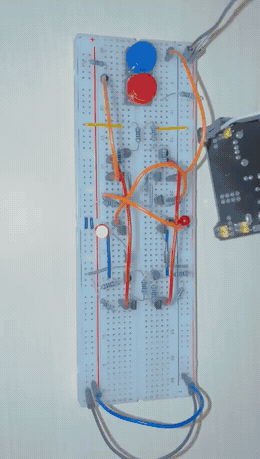
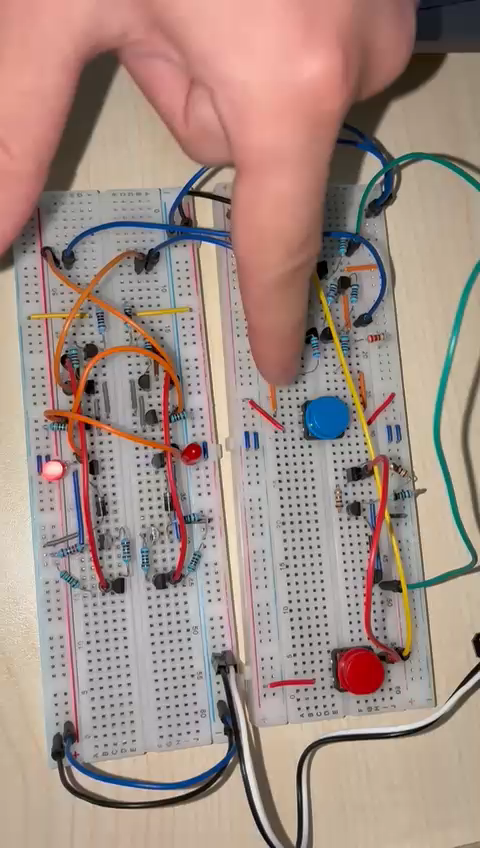
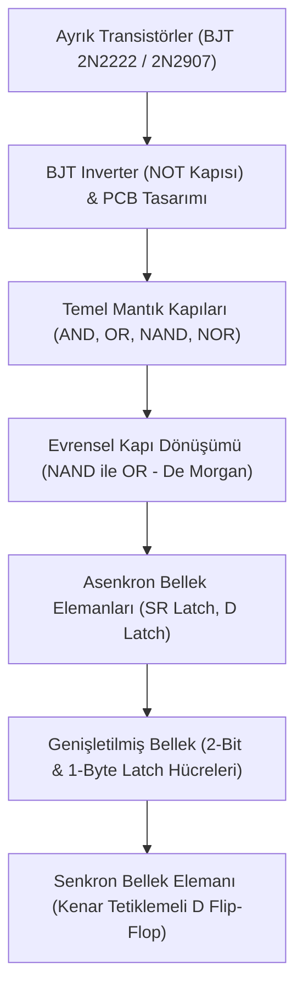
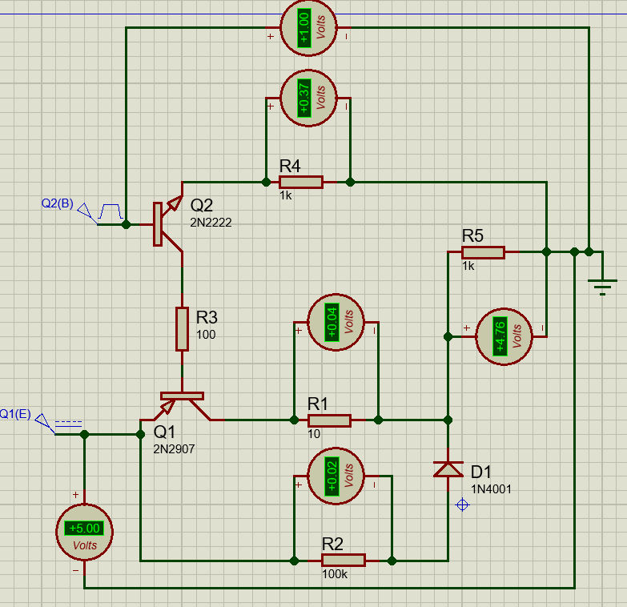
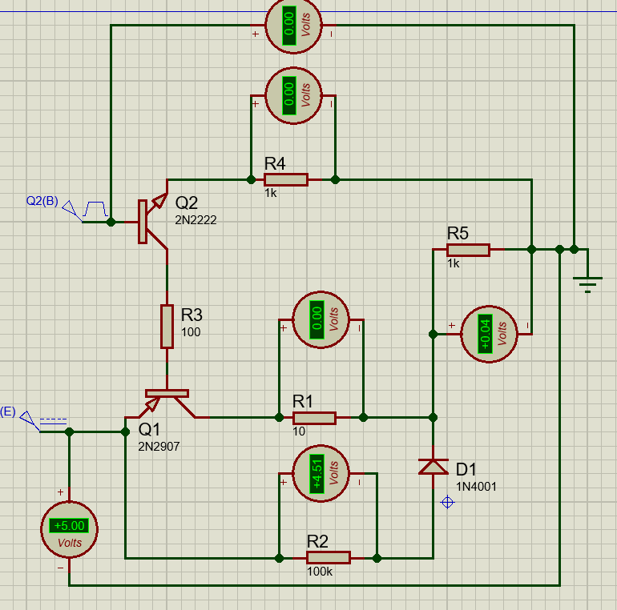
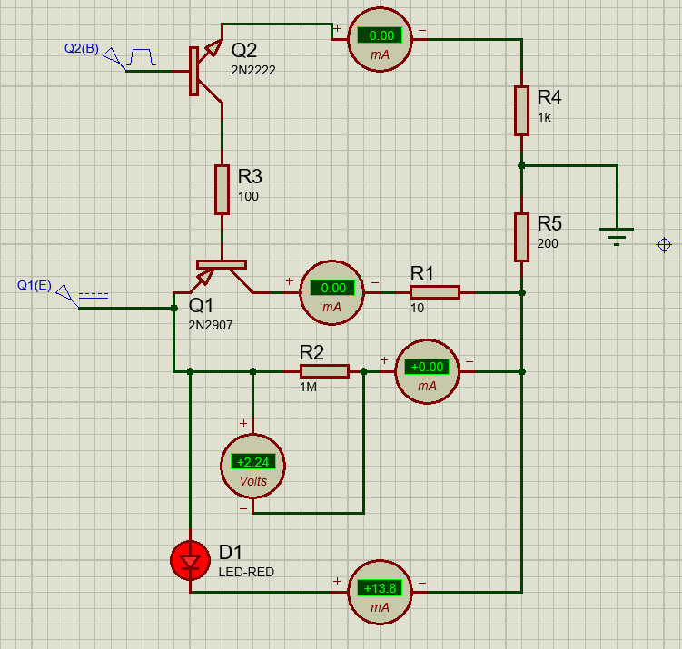
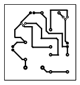

# ⚡ Sayısal Mantık ve Bellek Mimarisi Tasarımları (Proteus & Donanım Prototipi)

Bu proje; transistör seviyesinden başlayarak temel mantık kapılarına, bellek hücrelerine (Latch) ve saat tetiklemeli flip-flop mimarilerine uzanan **sayısal elektronik (digital logic)** devrelerinin **Proteus (ISIS & ARES)** üzerinde şematik tasarımı, simülasyonu, PCB çizimi ve **breadboard üzerinde fiziksel donanım uygulamasını** içermektedir.

---

## 🛠️ Fiziksel Donanım Prototipi (Breadboard Implementasyonu)

Projede iki aşamalı donanım prototipi geliştirilmiştir:
1. **1. Devre (Temel Mandal):** Ayrık BJT transistörlerle kurulan ve test edilen **NOR tabanlı SR Latch** devresi.
2. **2. Devre (Nihai Senkron Bellek):** SR Latch mimarisinin önüne iki adet AND kapısı ve bir evirici (inverter) eklenerek kararsız durumların önlendiği ve saat darbesiyle çalışan **Kenar Tetiklemeli D Flip-Flop** devresi.

Aşağıdaki canlı test kaydı ve donanım kurulumu:

<p align="center">
  <a href="https://www.youtube.com/shorts/m_t2LGcSsNU" target="_blank">
    
  </a>
  <br>
  <em>Şekil 1:SR latch breadboard canlı donanım testi. <b>Mavi Buton</b>: Clock (Saat) darbesi, <b>Kırmızı Buton</b>: Data (D) veri girişi, <b>LED'ler</b>: Q ve Q̄ durum göstergeleri.</em>
  <br><br>
  <a href="https://www.youtube.com/shorts/m_t2LGcSsNU" target="_blank">
    
  </a>
</p>

> 📺 **Canlı Uygulama Videosu:** Devrenin breadboard üzerindeki tam test ve çalışma videosunu izlemek için: [YouTube Shorts: D Flip-Flop Donanım Testi](https://www.youtube.com/shorts/m_t2LGcSsNU)

<p align="center">
  
  <br>
  <em>Şekil 2: İki breadboard üzerine kurulan ayrık transistörlü mantık ve D Flip-Flop bellek devresi donanım düzeni.</em>
</p>

---

## 📑 Proje Katmanları ve Devre Mimarileri



---

## 🔬 1. Ayrık Transistör Seviyesinde İnverter (NOT) Kapısı

Entegre devrelerin iç mimarisini anlamak amacıyla BJT transistörler (2N2222 NPN ve 2N2907 PNP) ve diyotlar kullanılarak push-pull / totem-pole yapısına benzer bir evirici (inverter) modellenmiştir.

### Simülasyon ve Mantık Durumları:
Devreler arası sinyal transferinde kapılar arası çalışma potansiyeli **1V** olarak belirlenmiştir. Yukarıdaki koldan uygulanan terslenecek sinyale (1V) göre transistörlerin doyum (saturation) ve kesim (cut-off) davranışları test edilmiştir:

| Mantık Durumu 1 (Giriş HIGH: 1V ➔ Çıkış LOW: 0.04V) | Mantık Durumu 2 (Giriş LOW: 0V ➔ Çıkış HIGH: 4.76V) |
| :---: | :---: |
|  |  |
| *Yukarıdaki giriş hattından 1.00V (Lojik 1) uygulandığında transistörler iletime geçerek çıkış gerilimini 0.04V (Lojik 0) seviyesine çeker.* | *Giriş hattı 0.00V (Lojik 0) iken transistörler kesime gider ve çıkış gerilimi +4.76V (Lojik 1) seviyesine yükselir.* |

### Akım Ölçümleri & ARES PCB Baskı Devre Tasarımı:
Kapıların birbirini sürmesi haricinde, devrenin tek başına harici bir LED yükünü sürebilmesi için akım sınırlayıcı dirençlerle optimize edilmiş LED sürücü varyasyonu ve tek katmanlı **ARES PCB (baskı devre)** plaket çizimi:

| LED Yüklü DC Akım Analizi (13.8 mA) | ARES Tek Katmanlı PCB Tasarımı |
| :---: | :---: |
|  |  |

---

## 🚪 2. Temel Mantık Kapıları & Evrensel Kapı Sentezi

Projede standart kapılar ve bunların evrensel kapılarla (Universal Gates) eşdeğerliği modellenmiştir:

* **AND Kapısı:** Her iki giriş de 1 olduğunda çıkış 1 olur.
* **OR Kapısı:** Girişlerden en az biri 1 olduğunda çıkış 1 olur.
* **NAND & NOR Kapıları:** Evrensel mantık kapılarıdır; diğer tüm kapılar sadece bu kapılar kullanılarak türetilebilir.
* **De Morgan Eşdeğerliği (`OR gate with NANDs`):**
  $$A + B = \overline{\overline{A} \cdot \overline{B}}$$
  Üç adet NAND kapısı bağlanarak OR fonksiyonu elde edilmiştir.

### Doğruluk Tabloları (Truth Tables)

| A | B | AND ($A \cdot B$) | OR ($A + B$) | NAND ($\overline{AB}$) | NOR ($\overline{A+B}$) |
| :-: | :-: | :-: | :-: | :-: | :-: |
| 0 | 0 | **0** | **0** | **1** | **1** |
| 0 | 1 | **0** | **1** | **1** | **0** |
| 1 | 0 | **0** | **1** | **1** | **0** |
| 1 | 1 | **1** | **1** | **0** | **0** |

---

## 💾 3. Asenkron Bellek Elemanları (Latches)

Kombinezonsal (combinational) mantıktan ardışıl (sequential) mantığa geçişin temeli olan geri beslemeli mandal yapıları:

### SR Latch (Set-Reset)
- **NAND Tabanlı SR Latch:** Aktif-düşük girişlerle çalışır ($\bar{S}, \bar{R}$).
- **NOR Tabanlı SR Latch:** Aktif-yüksek girişlerle çalışır.
- **Kararsız Durum (Forbidden State):** $S=1, R=1$ durumunda çıkışlar ($Q$ ve $\bar{Q}$) birbirine eşitlenir ve mantık çelişkisi doğar; bu durum engellenmelidir.

### Çok Bitli Bellek Mimarileri:
- **`SR LATCH 2bits.pdsprj`:** 2 bitlik bağımsız adreslenebilir/yazılabilir mandal yapısı.
- **`SR LATCH 1byte.pdsprj`:** 8 adet mandal hücresi bir araya getirilerek bilgisayar RAM ve yazmaç (register) mimarisinin temeli olan **1 Baytlık (8-bit) statik veri saklama hücresi** kurulmuştur.
- **`D LATCH.pdsprj`:** Data (D) ve Enable (E) girişleriyle kararsız durumu önleyen şeffaf mandal (transparent latch).

---

## ⏱️ 4. Senkron Bellek: Kenar Tetiklemeli D Flip-Flop (2. Devre Mimarisi)

- **Yapısal Tasarım:** D Flip-Flop devresi, **NOR tabanlı SR Latch** yapısının girişine iki adet AND kapısı ve bir adet evirici (inverter) eklenerek oluşturulmuştur.
- **Kararsız Durumun Önlenmesi:** Tek bir veri hattı ($D$) kullanıldığı için, giriş kapılarından birine $D$ doğrudan, diğerine ise terslenerek ($\bar{D}$) iletilir. Bu sayede SR Latch'lerdeki tehlikeli $S=1, R=1$ (kararsız/belirsiz) durumu yapısal olarak ortadan kalkar ve devre tam kararlılık kazanır.
- **Saat (Clock) Tetiklemesi:** Mandal devreleri seviye tetiklemeli (level-sensitive) iken, bu D Flip-Flop mimarisi saat darbesinin ($Clock$) $0 \to 1$ geçişinde (yükselen kenarında) veriyi çıkışa kilitler ($Q = D$). Saat darbesi gelmediği sürece veri girişindeki dalgalanmalar çıkışı etkilemez (yarış durumları - race conditions önlenir).
- **Fiziksel Prototip:** Breadboard üzerinde çalıştırılan ve videosu paylaşılan **2. Devre** tam olarak bu mimariyi temsil etmektedir (**Mavi Buton** = Clock, **Kırmızı Buton** = Data).

---

## 📂 Proje Dizin Yapısı

```text
📁 Digital-Logic-Design-Proteus/
├── 📁 01-Temel-Mantik-Kapilari/
│   ├── AND.pdsprj
│   ├── OR(basic).pdsprj
│   ├── NAND.pdsprj
│   ├── NOR(basic).pdsprj
│   └── OR gate with NANDs.pdsprj
│
├── 📁 02-Mandal-Devreleri-Latches/
│   ├── NOR LATCH.pdsprj
│   ├── SR LATCH with NANDs.pdsprj
│   ├── SR LATCH 2bits.pdsprj
│   ├── SR LATCH 1byte.pdsprj
│   └── D LATCH.pdsprj
│
├── 📁 03-Flip-Flop-Tasarimlari/
│   ├── D FLİP FLOP.pdsprj
│   └── D FLİP FLOP (final).pdsprj
│
├── 📁 04-BJT-Inverter-NOT-Tasarimi/
│   ├── İnverter(NOT).pdsprj
│   ├── proje1.pdsprj
│   ├── 2.0.pdsprj
│   ├── 2 kullanım.pdsprj
│   └── proje1.PDF              (ARES Tek Katmanlı PCB Çıktısı)
│
├── 📁 docs/images/             (Devre şemaları, PCB ve donanım görselleri)
├── 📄 .gitignore               (Proteus çalışma alanı ve yedek çöplerini engeller)
└── 📄 README.md                (Detaylı görsel proje dokümantasyonu)
```

---

## 🚀 Devreleri Çalıştırma ve Simülasyon

1. Bilgisayarınızda **Proteus 8.0 veya üzeri** (ISIS & ARES) kurulu olduğundan emin olun.
2. İlgili klasöre girip `.pdsprj` uzantılı devre dosyasını çift tıklayarak açın.
3. Sol alt köşedeki **Play / Run Simulation (F12)** butonuna basarak mantık butonları ve prob göstergeleri üzerinden devreyi interaktif olarak simüle edin.

---

## 👤 Hazırlayan

- **Efe Anıl Arslan**
- Sayısal Elektronik ve Donanım Tasarımı Çalışması
