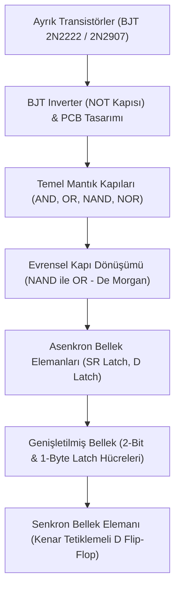

# ⚡ Sayısal Mantık ve Bellek Mimarisi Tasarımları (Proteus & Donanım Prototipi)

Bu proje; transistör seviyesinden başlayarak temel mantık kapılarına, bellek hücrelerine (Latch) ve saat tetiklemeli flip-flop mimarilerine uzanan **sayısal elektronik (digital logic)** devrelerinin **Proteus (ISIS & ARES)** üzerinde şematik tasarımı, simülasyonu, PCB çizimi ve **breadboard üzerinde fiziksel donanım uygulamasını** içermektedir.

---

## 🛠️ Fiziksel Donanım Prototipi (Breadboard Implementasyonu)

Ayrık bileşenler (BJT transistörler, dirençler, butonlar ve LED'ler) kullanılarak breadboard üzerinde kurulan mantık devresinin gerçek zamanlı çalışması:

<p align="center">
  
  <br>
  <em>Şekil 1: Buton tetiklemeli transistörlü mandal/bellek devresinin fiziksel test anı (Set/Reset durumları ve LED göstergeleri).</em>
</p>

<p align="center">
  
  <br>
  <em>Şekil 2: İki breadboard üzerine kurulan ayrık transistörlü mantık ve bellek devresi donanım düzeni.</em>
</p>

---

## 📑 Proje Katmanları ve Devre Mimarileri



---

## 🔬 1. Ayrık Transistör Seviyesinde İnverter (NOT) Kapısı

Entegre devrelerin iç mimarisini anlamak amacıyla BJT transistörler (2N2222 NPN ve 2N2907 PNP) ve diyotlar kullanılarak push-pull / totem-pole yapısına benzer bir evirici (inverter) modellenmiştir.

### Simülasyon ve Mantık Durumları:
Giriş gerilimine göre transistörlerin doyum (saturation) ve kesim (cut-off) bölgeleri test edilmiş, düğüm gerilimleri doğrulanmıştır:

| Mantık Durumu 1 (Giriş LOW -> Çıkış HIGH) | Mantık Durumu 2 (Giriş HIGH -> Çıkış LOW) |
| :---: | :---: |
|  |  |
| *Giriş 0V iken çıkışta +4.76V (Lojik 1) elde edilir.* | *Giriş 5V iken çıkış gerilimi 0V seviyesine çöker (Lojik 0).* |

### Akım Ölçümleri & ARES PCB Baskı Devre Tasarımı:
Yük olarak LED bağlandığında çekilen akım seviyeleri (13.8 mA) ve devrenin tek katmanlı **ARES PCB (baskı devre)** plaket çizimi:

| LED Yüklü DC Akım Analizi | ARES Tek Katmanlı PCB Tasarımı |
| :---: | :---: |
|  |  |

---

## 🚪 2. Temel Mantık Kapıları & Evrensel Kapı Sentezi

Projede standart kapılar ve bunların evrensel kapılarla (Universal Gates) eşdeğerliği modellenmiştir:

* **AND Kapısı:** Her iki giriş de 1 olduğunda çıkış 1 olur.
* **OR Kapısı:** Girişlerden en az biri 1 olduğunda çıkış 1 olur.
* **NAND & NOR Kapıları:** Evrensel mantık kapılarıdır; diğer tüm kapılar sadece bu kapılar kullanılarak türetilebilir.
* **De Morgan Eşdeğerliği (`OR gate with NANDs`):**
  $$A + B = \overline{\overline{A} \cdot \overline{B}}$$
  Üç adet NAND kapısı bağlanarak OR fonksiyonu elde edilmiştir.

### Doğruluk Tabloları (Truth Tables)

| A | B | AND ($A \cdot B$) | OR ($A + B$) | NAND ($\overline{AB}$) | NOR ($\overline{A+B}$) |
| :-: | :-: | :-: | :-: | :-: | :-: |
| 0 | 0 | **0** | **0** | **1** | **1** |
| 0 | 1 | **0** | **1** | **1** | **0** |
| 1 | 0 | **0** | **1** | **1** | **0** |
| 1 | 1 | **1** | **1** | **0** | **0** |

---

## 💾 3. Asenkron Bellek Elemanları (Latches)

Kombinezonsal (combinational) mantıktan ardışıl (sequential) mantığa geçişin temeli olan geri beslemeli mandal yapıları:

### SR Latch (Set-Reset)
- **NAND Tabanlı SR Latch:** Aktif-düşük girişlerle çalışır ($\bar{S}, \bar{R}$).
- **NOR Tabanlı SR Latch:** Aktif-yüksek girişlerle çalışır.
- **Kararsız Durum (Forbidden State):** $S=1, R=1$ durumunda çıkışlar ($Q$ ve $\bar{Q}$) birbirine eşitlenir ve mantık çelişkisi doğar; bu durum engellenmelidir.

### Çok Bitli Bellek Mimarileri:
- **`SR LATCH 2bits.pdsprj`:** 2 bitlik bağımsız adreslenebilir/yazılabilir mandal yapısı.
- **`SR LATCH 1byte.pdsprj`:** 8 adet mandal hücresi bir araya getirilerek bilgisayar RAM ve yazmaç (register) mimarisinin temeli olan **1 Baytlık (8-bit) statik veri saklama hücresi** kurulmuştur.
- **`D LATCH.pdsprj`:** Data (D) ve Enable (E) girişleriyle kararsız durumu önleyen şeffaf mandal (transparent latch).

---

## ⏱️ 4. Senkron Bellek: Kenar Tetiklemeli D Flip-Flop

- Mandal devreleri seviye tetiklemeli (level-sensitive) iken, **D Flip-Flop** saat darbesinin (Clock) yükselen veya düşen kenarında veriyi kilitler.
- Yarış durumlarını (race conditions) ortadan kaldırır.
- Projede ana-uydu (master-slave) prensibine dayalı nihai D Flip-Flop tasarımı simüle edilmiştir.

---

## 📂 Proje Dizin Yapısı

```text
📁 Digital-Logic-Design-Proteus/
├── 📁 01-Temel-Mantik-Kapilari/
│   ├── AND.pdsprj
│   ├── OR(basic).pdsprj
│   ├── NAND.pdsprj
│   ├── NOR(basic).pdsprj
│   └── OR gate with NANDs.pdsprj
│
├── 📁 02-Mandal-Devreleri-Latches/
│   ├── NOR LATCH.pdsprj
│   ├── SR LATCH with NANDs.pdsprj
│   ├── SR LATCH 2bits.pdsprj
│   ├── SR LATCH 1byte.pdsprj
│   └── D LATCH.pdsprj
│
├── 📁 03-Flip-Flop-Tasarimlari/
│   ├── D FLİP FLOP.pdsprj
│   └── D FLİP FLOP (final).pdsprj
│
├── 📁 04-BJT-Inverter-NOT-Tasarimi/
│   ├── İnverter(NOT).pdsprj
│   ├── proje1.pdsprj
│   ├── 2.0.pdsprj
│   ├── 2 kullanım.pdsprj
│   └── proje1.PDF              (ARES Tek Katmanlı PCB Çıktısı)
│
├── 📁 docs/images/             (Devre şemaları, PCB ve donanım görselleri)
├── 📄 .gitignore               (Proteus çalışma alanı ve yedek çöplerini engeller)
└── 📄 README.md                (Detaylı görsel proje dokümantasyonu)
```

---

## 🚀 Devreleri Çalıştırma ve Simülasyon

1. Bilgisayarınızda **Proteus 8.0 veya üzeri** (ISIS & ARES) kurulu olduğundan emin olun.
2. İlgili klasöre girip `.pdsprj` uzantılı devre dosyasını çift tıklayarak açın.
3. Sol alt köşedeki **Play / Run Simulation (F12)** butonuna basarak mantık butonları ve prob göstergeleri üzerinden devreyi interaktif olarak simüle edin.

---

## 👤 Hazırlayan

- **Efe Anıl Arslan**
- Sayısal Elektronik ve Donanım Tasarımı Çalışması
